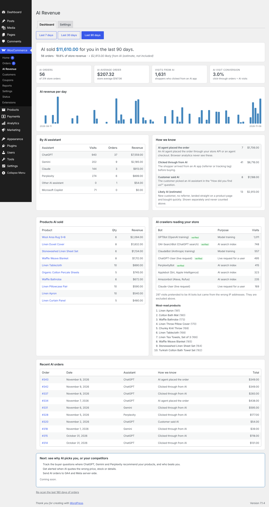

# AI Revenue Tracker for WooCommerce

See how much ChatGPT, Perplexity, Gemini, Claude, Copilot and AI shopping agents sell for a WooCommerce store.



## What's here

| Folder | What it is |
| --- | --- |
| `ai-revenue-tracker/` | The free WordPress plugin. Zip this folder to install it or submit it to WordPress.org. |
| `demo/seed.php` | Fills a test store with sample products, 90 days of orders and AI activity. Demo use only. |
| `demo/blueprint.json` | WordPress Playground setup: opens a working demo store in the browser, no hosting needed. |
| `demo/blueprint-local.json` | The same setup for running the demo on your own machine. |

## Try the demo

Open the live demo (no install needed):

**https://playground.wordpress.net/#https://raw.githubusercontent.com/natejameson/free-woo-ai-revenue/main/demo/blueprint.json**

The demo takes about a minute to load. It installs WooCommerce and the plugin, creates the sample store and opens the AI Revenue dashboard.

To run it locally instead (Node.js 20+):

```bash
npx @wp-playground/cli server --blueprint=demo/blueprint-local.json \
  --mount=./ai-revenue-tracker:/wordpress/wp-content/plugins/ai-revenue-tracker \
  --mount=./demo/seed.php:/wordpress/airt-demo-seed.php
```

Then open http://127.0.0.1:9400/wp-admin/admin.php?page=airt and log in with `admin` / `password`.

## Before publishing to WordPress.org

- Replace `yourwporgusername` in `ai-revenue-tracker/readme.txt` with your WordPress.org username.
- Set the author and plugin URI in `ai-revenue-tracker/ai-revenue-tracker.php`.
- Set `AIRT_PRO_URL` to your waitlist or pricing page to turn on the upgrade button.
- Screenshots for the listing go in the plugin's SVN `assets/` folder, not in the plugin zip.

## Tested

- WordPress 7.1.4, WooCommerce 11.2.1, PHP 8.2, High-Performance Order Storage
- Real Store API checkouts: an AI click-through, an AI agent order and a normal order were each attributed correctly
- 52 unit tests for detection, IP verification and attribution, 6 for the browser script
